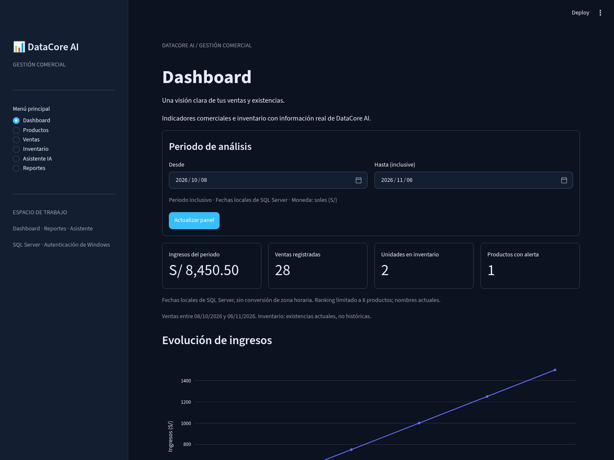
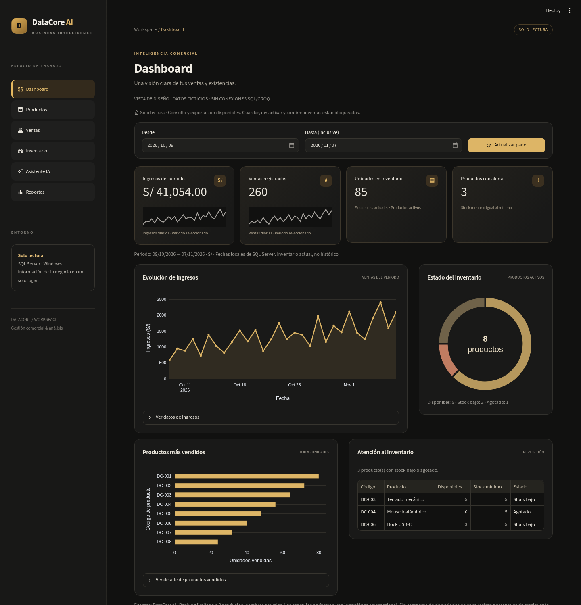

# Rediseño visual: grafito y ámbar

Actualización de la misma PR #8. Se conserva Streamlit y la separación app/views/
database/services. No se modifica SQL, datos ni la capa de negocio.

La imagen de referencia mencionada no se recibió como adjunto visible en esta
conversación. El diseño se construyó sobre los requisitos escritos; no se afirma
una reproducción exacta ni una comparación píxel a píxel con esa imagen.

## Sistema visual

- Fondo negro #111110, superficies grafito #191918/#20201E, bordes #37352F,
  texto marfil #E9E5DC y acento ámbar #DDB566.
- Tipografía sans serif del entorno, jerarquía compacta y sin fuentes remotas
  añadidas. Cabecera, breadcrumb, estado de operación y pie compartidos.
- Marca propia y navegación lateral con seis botones nativos, iconos Material,
  selección ámbar y ayuda accesible. Conserva las etiquetas y el estado de sesión.
- Tarjetas KPI con iconos, importes visibles y micrográficos de las series diarias
  consultadas. Cuatro columnas en escritorio, dos en tablet y una en móvil.
- Gráfico de ingresos con área ámbar, donut de inventario actual y ranking por
  unidades en paneles equilibrados. Inventario incluye existencias por producto
  con su límite de visualización explícito y una tabla alternativa.
- Formularios, tablas, filtros, estados, botones y respuesta del asistente reciben
  el mismo tema. Las acciones principales usan texto oscuro sobre ámbar.

## Compatibilidad y CSS

La versión instalada/validada es Streamlit 1.67; se actualiza el mínimo declarado
a >=1.67. El archivo de constraints sigue fijando las mismas versiones instaladas.
No se añade framework ni dependencia de ejecución.

`assets/premium.css` utiliza clases propias `dc-*`, etiquetas HTML y los hooks
`st-key-*` de contenedores con clave explícita. No usa clases `st-emotion-*`,
atributos `data-testid`, IDs generados ni selectores de posición de widgets.
El ajuste relacional :has de la cuadrícula se limita a las claves propias de
las cuatro tarjetas; se verificó en Chromium a distintas anchuras. El menú y
las acciones son botones Streamlit reales, con callbacks y teclas nativos.
El tema de formularios/tablas se configura mediante opciones oficiales, no
mediante cambios del DOM interno. El HTML propio escapa sus textos dinámicos.

## Datos y funciones preservados

- No hay deltas ni porcentajes de crecimiento sin datos comparables. El resumen
  actual no consulta un periodo anterior; por tanto no se inventan tendencias.
- Los micrográficos usan únicamente las series diarias recibidas. El donut cuenta
  productos activos disponibles, bajos y agotados según las existencias reales.
- Las categorías vacías, consultas fallidas y conjuntos sin ventas siguen mostrando
  estados diferenciados. No se rellena el panel con datos de demostración.
- Continúan catálogo/ROWVERSION, carrito/UUID, historial, filtros, tres exportaciones
  y asistente guiado/Groq opcional. Se mantiene bloqueo de escrituras en modo lector.
- Las capturas usan un proceso temporal con datos ficticios y SQL/HTTP bloqueados;
  ese origen de datos no se incorpora al funcionamiento normal de la aplicación.

## Validación

Suite aislada Python 3.13: 86 descubiertas, 82 aprobadas y 4 SQL optativas omitidas;
0 errores y 0 intentos SQL/HTTP reales. Las pruebas de navegación se adaptan a los
botones nuevos conservando sus aserciones sobre datos, sesión y escrituras.
Una regresión nueva verifica métricas, ausencia de deltas y clasificación del donut.

Chromium/Playwright recorre las seis rutas en escritorio y móvil. Se comprueban
paneles cargados, modo lector y descargas CSV/Excel/PDF con datos ficticios.
Se revisa Dashboard a 320/390/768/1440 px: sin desbordamiento global y sin truncar
el importe de la tarjeta en tablet. Las tablas anchas mantienen scroll interno.
Los checks de la PR publican el resultado por commit en Ubuntu y Windows.
Esto no demuestra funcionamiento con SQL Server Express ni Groq reales.

## Capturas para revisión

**Antes** (etapa anterior, datos ficticios distintos; comparar diseño, no cifras):

**Después** (proceso temporal con datos ficticios, sin conexiones externas):

| Pantalla | Escritorio | Móvil |
| --- | --- | --- |
| Dashboard | [Captura](imagenes/premium/desktop-dashboard.png) | [Captura](imagenes/premium/movil-dashboard.png) |
| Productos | [Captura](imagenes/premium/desktop-productos.png) | [Captura](imagenes/premium/movil-productos.png) |
| Ventas | [Captura](imagenes/premium/desktop-ventas.png) | [Captura](imagenes/premium/movil-ventas.png) |
| Inventario | [Captura](imagenes/premium/desktop-inventario.png) | [Captura](imagenes/premium/movil-inventario.png) |
| Reportes | [Captura](imagenes/premium/desktop-reportes.png) | [Captura](imagenes/premium/movil-reportes.png) |
| Asistente IA | [Captura](imagenes/premium/desktop-asistente.png) | [Captura](imagenes/premium/movil-asistente.png) |

Pendiente: contrastar con la imagen original cuando esté disponible y revisar en
la computadora del propietario los casos de [aceptación local](PRUEBAS_LOCALES_V1.md).
No se fusiona main ni se presenta esta candidata como despliegue de producción.
