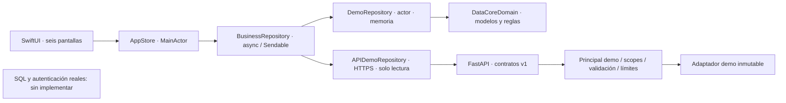

# Arquitectura iOS + API demo

Actualización: `CommercialSession` ahora reside en el paquete Foundation/Observation
y se prueba en Linux. `AppStore` es un alias y extensión de conexión HTTPS; SwiftUI
inyecta la sesión con `@Environment`/`@State` de iOS 17.
Consulta [el fallo de arquitecturas y corrección actual](IOS_MODULE_DEPENDENCY_FIX.md).
Debug del proyecto usa ONLY_ACTIVE_ARCH=YES como SwiftPM; Release conserva NO.

## Alcance y ascendencia

`feature/datacore-ios` parte de `17658bf` de la propuesta más reciente #11,
que contiene #10, #9 y #8. Su PR tiene como base `design/visualizaciones-filtros-v4`
para revisar solo iOS/API/documentación, conservando ascendencia sin copiar
commits. No se cambia la aplicación Streamlit, sus servicios, acceso SQL,
exportadores, configuración visual o reglas comerciales existentes. Main no se
fusiona. El repositorio sigue privado.

## Componentes y límites

- `ios/DataCoreAI/`: aplicación iPhone SwiftUI/Swift Charts; cuatro pestañas
  principales Inicio/Productos/Ventas/Más, con Inventario/Reportes/Asistente bajo
  Más. Evita seis pestañas estrechas y navegación automática oculta del sistema.
- `ios/Packages/DataCoreDomain/`: paquete local Foundation sin UIKit/SwiftUI/red,
  modelos Codable/Sendable, Period, Quote, CSV y actor demo. Sus pruebas se ejecutan
  en Linux/macOS. No hay dependencias Swift externas.
- `AppStore`: estado de UI aislado a MainActor, carga y errores explícitos, carrito,
  historial y consultas. Cambiar repositorio limpia la sesión; un identificador de
  generación impide que una respuesta vieja sobrescriba un origen nuevo.
- `BusinessRepository`: contrato intercambiable sin detalles SQL. El adaptador remoto
  es **API demo, no producción**, y rechaza checkout. La futura implementación de
  producción debe ser otro adaptador con revisión de identidad/seguridad; no es un
  interruptor listo para conectar datos comerciales.
- `api/`: FastAPI autónomo con entorno y constraints propios. Nueve operaciones
  OpenAPI, datos inmutables, previsualización sin persistencia. No importa ninguna
  capa existente de Streamlit ni permite escrituras en SQL.
- `contracts/`: fixture canónico y OpenAPI versionados. API y paquete incluyen copias
  de fixture iguales byte a byte, verificadas en pruebas. Los importes JSON son
  `*_minor`, enteros PEN: S/ 49.90 se representa como 4990.

## Reglas comerciales de demostración

La semana fija 2026-11-01 a 2026-11-07 deriva **S/ 1,347.70** de siete ventas,
83 unidades actuales y tres alertas. Se incluyen días con ingreso cero, sin
porcentajes ni comparaciones inventados. El catálogo actual puede tener precios
iguales o distintos a ventas históricas; cada línea guarda el precio vendido.
Las existencias son actuales, nunca se infieren existencias históricas.

La demo iOS valida carrito completo, stock, cantidades enteras 1–999, máximo 50
líneas sin duplicados e importes antes de mutar memoria. El actor realiza el commit
sin puntos de suspensión: descuenta stock y agrega venta juntos. Un UUID se
conserva mientras no cambie el carrito; mismo UUID/contenido devuelve el recibo;
otro contenido se rechaza. Topes: 1000 confirmaciones por sesión/5000 ventas.
No es transacción SQL ni recuperación durable: al terminar el proceso se pierde
la sesión. No reutilizar esta estrategia en producción sin idempotencia durable.

El motor Swift usa Int64 con validación y cotas de entrada que evitan overflow.
Python usa enteros estrictos; el ticket promedio se redondea explícitamente solo
para mostrar. Double se usa únicamente al dibujar gráficos. Los totales de venta
no se calculan con coma flotante. El promedio vacío no se presenta como cero.

## Experiencia nativa

Petróleo #0D1726, violeta #7659E8, turquesa #24C9C0, blanco frío #F2F5FA;
superficies adaptadas al modo oscuro. Dashboard con panel principal de ingresos,
indicadores secundarios, gráfico seleccionable por fecha y reposición. Productos
usa catálogo/ficha; Ventas, flujo de preparación/carrito/confirmación/historial;
Inventario, monitor por estados; Reportes, configuración/evidencia/compartir;
Asistente, conversación guiada con fuentes. No hay WebView ni HTML de negocio.

Se utilizan Label, List, Form, NavigationStack, sheets, menús, búsqueda y share sheet
nativos. ViewThatFits, ScrollView y fuentes semánticas evitan alturas rígidas de
formularios. Los gráficos tienen tabla/texto alternativos; Reduce Motion elimina
la animación de cambio de serie. Revisión de accesibilidad física pendiente.

## Reportes y memoria

CSV UTF-8 con BOM, CRLF, campos entrecomillados, neutralización de prefijos fórmula,
fechas, moneda, etiqueta DEMO y total. PDF UIKit paginado con fuentes del sistema.
La UI genera archivos solo al pulsar Preparar; comparte mediante ShareLink, con
aviso de entrega a otras apps. Usa directorio temporal propio, protección completa,
máximo ocho archivos por sesión y limpieza al próximo inicio. Excel nativo iOS
no está implementado; se mantienen intactas las exportaciones Streamlit.

## Evolución de producción: puertas que faltan

1. Identidad OIDC/OAuth Authorization Code + PKCE con ASWebAuthenticationSession;
   tokens cortos y refresh seguro en Keychain. El helper Keychain existe, no hay
   login ni tokens configurados. Nunca incluir Groq/secretos en el bundle.
2. API debe validar emisor, audiencia, expiración, algoritmo permitido, claves
   rotables y revocación; obtener usuario/empresa desde identidad validada.
3. Autorizar scopes/roles y empresa en cada servicio/consulta; probar aislamiento
   entre usuarios. No aceptar selección de tenant por una cabecera arbitraria.
4. Adaptador SQL separado con cuenta de lectura, consultas parametrizadas y
   allowlist fija; sin conexión pública al motor SQL ni SQL generado por modelos.
   No reutilizar sin más las escrituras Streamlit desde endpoints móviles.
5. TLS/gateway autorizado, rate limit distribuido, timeouts, límites de volumen,
   paginación y observabilidad con política de retención. Nada de esto se despliega
   por esta PR. La tasa en memoria demo no es defensa de producción distribuida.
6. Si se habilita Groq en servidor: credencial de servidor, consentimiento, contexto
   mínimo agregado, política/retención verificada y respuesta como texto sin tools
   ni ejecución. La demo iOS/API actual no llama a Groq.
7. Revisar cuentas, exportación/borrado, datos personales, privacidad y cumplimiento
   con prácticas reales antes de habilitar usuarios o enviar a App Review.
