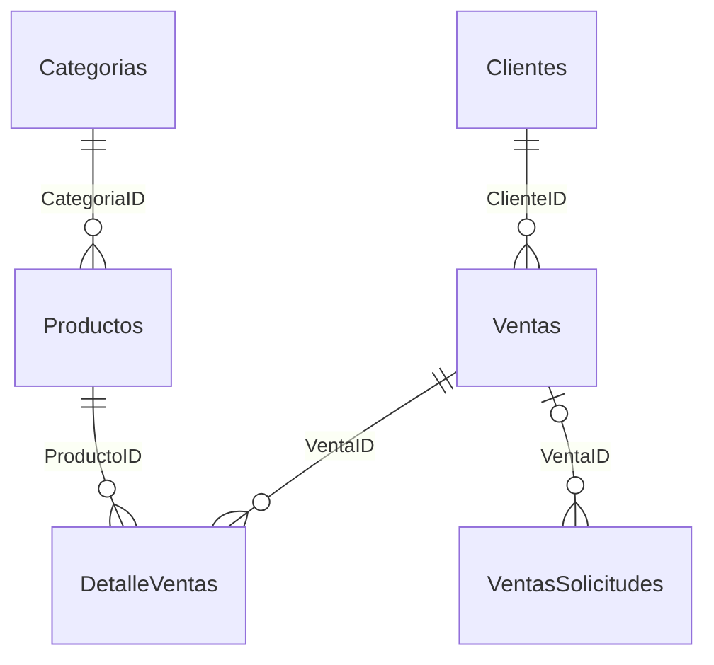

# Fuente SQL original y consolidación Atlas

El usuario confirmó que **los scripts SQL son la fuente original**. Se revisaron las 22 ramas remotas y los heads de PR disponibles por Git. Los tres archivos originales tienen el mismo contenido en esas ramas. No apareció un respaldo `.bak/.bacpac`, archivo `.mdf/.ldf` ni exportación de una instancia real. La revisión de títulos, comentarios y estados de PR mediante GitHub API está pendiente por la política de red; no se infiere a partir de los heads.

## Archivos conservados

No se ejecutaron ni modificaron estos scripts. Ya estaban presentes en el commit inicial `aec82f3`.

| Archivo | Contenido | SHA-256 del texto con saltos LF |
| --- | --- | --- |
| [01_crear_base_y_tablas.sql](../sql/01_crear_base_y_tablas.sql) | Cinco tablas principales, PK, FK, defaults y CHECK. | `0c8bf9fc3378e47e1bfe511acf69cc1d76ff56d6e2e831fec746d335a18ab135` |
| [02_datos_prueba.sql](../sql/02_datos_prueba.sql) | Cuatro categorías, veinte productos y diez clientes ficticios. | `0f2ea3641f406bbaf74ca92271fc8f7b01baec52f291cea2dc522f15711bcbe0` |
| [03_solicitudes_ventas.sql](../sql/03_solicitudes_ventas.sql) | Tabla auxiliar de idempotencia. | `c7f8edc8926bace5c193bf9fcac8326fbe499975a773f331fd9e7df31276ab93` |

Estos hashes describen los archivos auditados, no el contenido de un SQL Server en ejecución. Git puede convertir finales de línea en un checkout de Windows; la procedencia generada normaliza CRLF a LF sin reescribir los scripts.

## Modelo verificado en los archivos

| Tabla | PK | Relaciones y restricciones principales |
| --- | --- | --- |
| `Categorias` | `CategoriaID` INT IDENTITY | Nombre único y no vacío. |
| `Productos` | `ProductoID` INT IDENTITY | CategoriaID → Categorias; Codigo único; precio, existencias y mínimo no negativos; Activo, FechaCreacion, ROWVERSION. Mínimo predeterminado 5. |
| `Clientes` | `ClienteID` INT IDENTITY | Documento único; nombre/documento no vacíos; correo/teléfono opcionales; Activo. |
| `Ventas` | `VentaID` INT IDENTITY | ClienteID → Clientes; Fecha DATETIME2; Total DECIMAL(12,2) no negativo. |
| `DetalleVentas` | `DetalleVentaID` INT IDENTITY | VentaID → Ventas; ProductoID → Productos; cantidad positiva; precio/subtotal no negativos; Subtotal = Cantidad × PrecioUnitario. |
| `VentasSolicitudes` | `SolicitudID` UNIQUEIDENTIFIER | VentaID opcional → Ventas; huella CHAR(64), FechaCreacion; soporte de solicitudes idempotentes. |

Los scripts conservan tablas preexistentes y no corrigen automáticamente un esquema incompatible. Se verificaron las definiciones del repositorio; no se certifica que una instancia física tenga esas mismas restricciones.

## Registros que se pueden recuperar

`scripts/sql_original.py` lee los archivos, verifica cantidades, unicidad de claves de negocio y referencias de categoría. No abre ODBC. Genera `pwa/js/sql-fixtures.js`, con los hashes y estado `connected:false`.

- Productos `DEMO-001` a `DEMO-020`, sin cambiar código, nombre, categoría, precio, existencias o mínimo.
- Categorías Tecnología, Papelería, Hogar y Accesorios; cinco productos por categoría.
- Diez clientes `DEMO-C001` a `DEMO-C010`, explícitamente ficticios en la fuente. La demo pública muestra solo nombre y documento de prueba, sin teléfonos ni correos.
- Existencias declaradas: **336 unidades**, seis referencias en o por debajo del mínimo, una agotada. No tienen fecha de lectura y no certifican stock actual.

La UI usa Codigo y Documento como claves de negocio. **No inventa valores de ProductoID, CategoriaID o ClienteID**, porque IDENTITY depende de la instancia y del orden real de inserción.

## Datos ausentes, sin sustitución

Los scripts no contienen filas de `Ventas`, `DetalleVentas` o `VentasSolicitudes`. Tampoco hay registros de sucursales, costos, metas, horarios de actividad ni fechas de captura del inventario. Esto no demuestra que la base local carezca de ventas; demuestra que ese historial no está en los archivos entregados.

Por ello ingresos, pedidos, ticket, evolución, períodos y rentabilidad permanecen **no disponibles**. No se sustituyen por cero. No se dibujan áreas, heatmaps comerciales ni objetivos sin sus datos. Los gráficos representan existencias y precios originales: ranking, estado radial, matriz de productos, barras/donut por categoría, treemap de unidades o valor de catálogo y dispersión precio/stock. El valor de catálogo se calcula como existencias × precio, sin atribuirlo a ingresos o costos.

Las versiones anteriores añadían productos PWA/iOS y ventas generadas. Continúan recuperables en el historial Git y la rama base `design/atlas-editorial`, pero se excluyen de esta vista SQL para no mezclarlos silenciosamente con la fuente que confirmó el usuario. No se han eliminado ni alterado registros de una base de datos.

La cotización añadida a Ventas es un cálculo transitorio sobre los mismos productos y clientes de prueba. No inserta registros, no descuenta stock, no inventa claves y no se agrega a un historial comercial.

## Integración preparada

Consulta [backend/README.md](../backend/README.md). API de lectura autenticada, parámetros ODBC, validación, límites, autorización por scopes y TLS verificado. No hay conexión directa desde JavaScript. No existe SQL Server ni ODBC Driver 18 en este entorno Linux; no hay conexión real ni carga autenticada de datos en la PWA pública. No se expone el equipo Windows a Internet.
