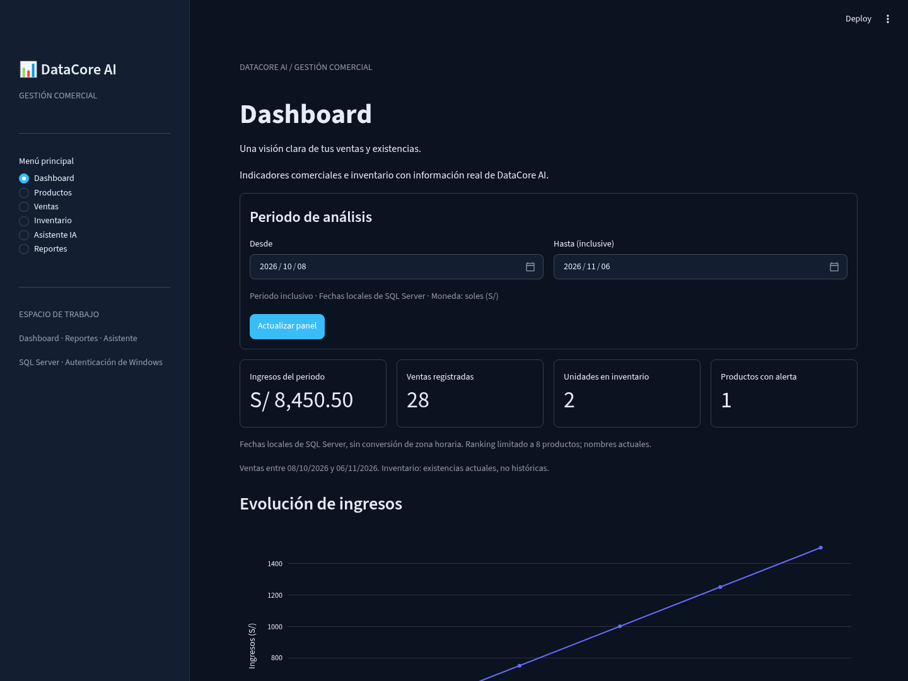
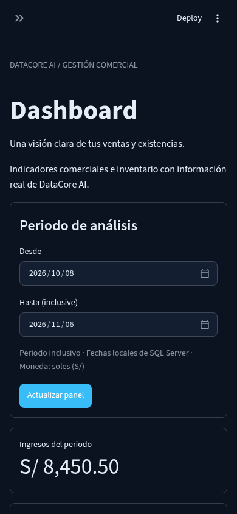
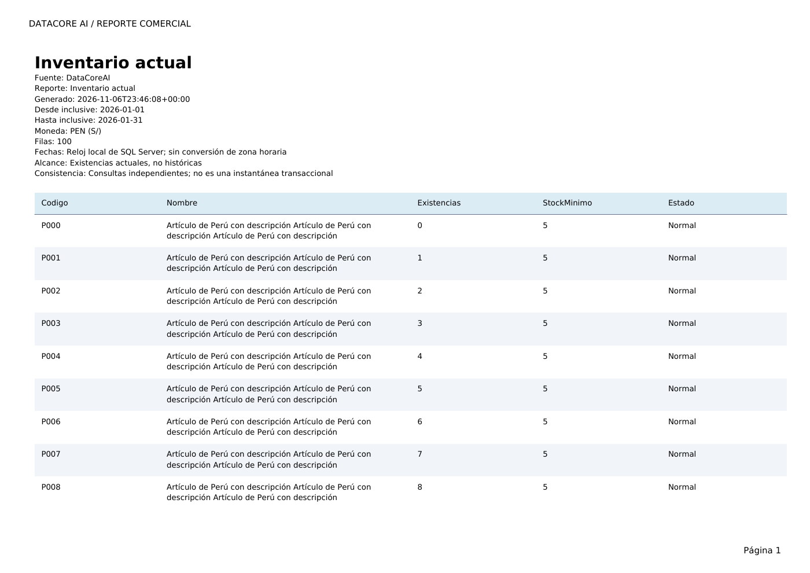
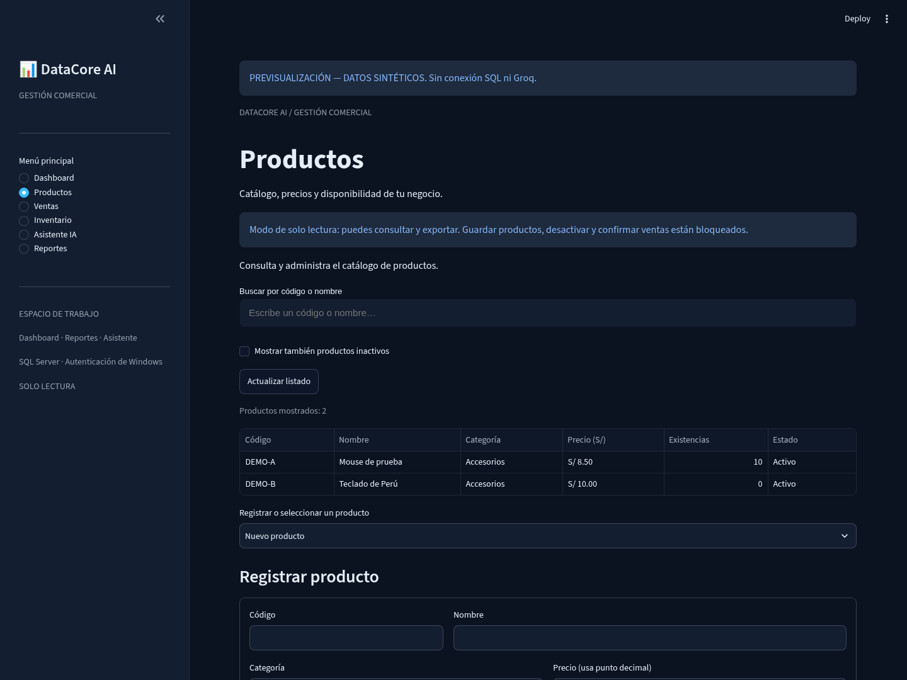
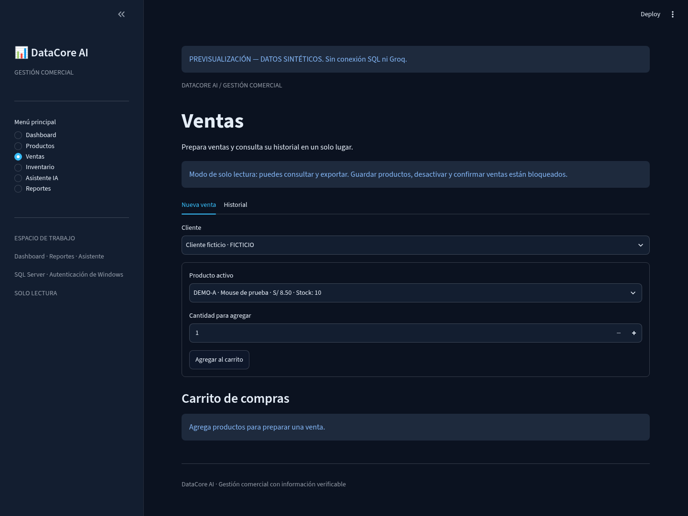
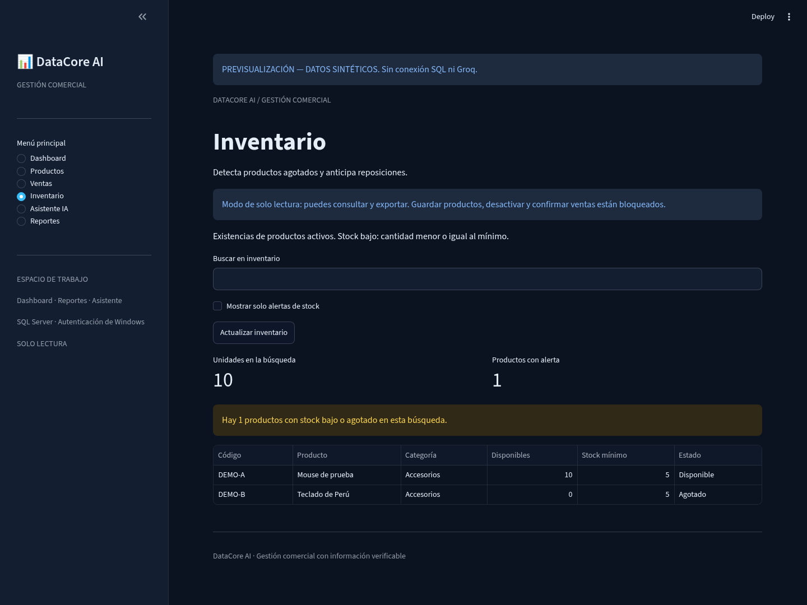
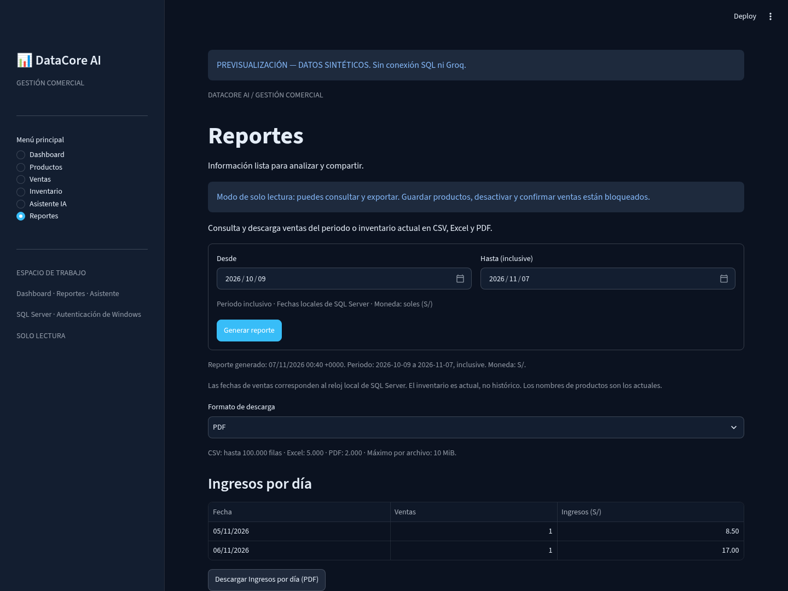
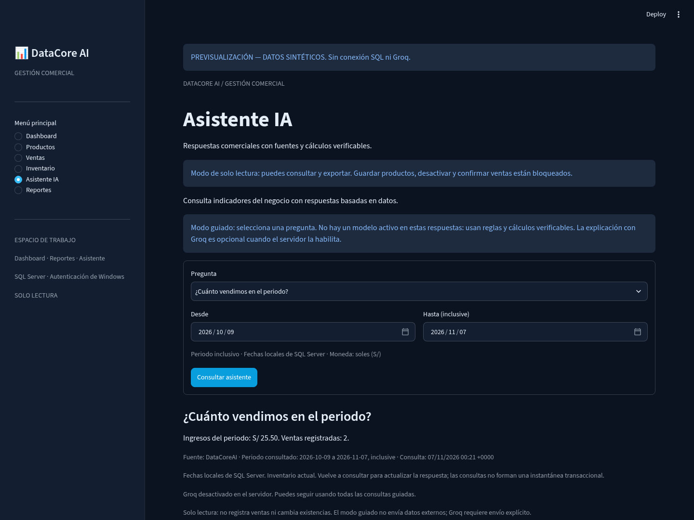

# Revisión visual con datos sintéticos

Estas capturas usan exclusivamente datos ficticios inyectados en un proceso
Streamlit temporal. No son evidencia de conexión ni cifras de un negocio real.
El script de previsualización no se incorpora a la aplicación ni altera SQL.

Chromium con Playwright: dashboard y reportes a 1440 px; entrada móvil a 390 px.
Se verificaron filtros, métricas, jerarquía, contraste, navegación y tablas.
La pantalla móvil inicia con menú contraído y mide 390 px de documento para
390 px de viewport, sin desbordamiento horizontal global. Las tablas anchas
conservan su desplazamiento interno. Se mantiene el tema oscuro original.

PDF sintético de 100 filas renderizado con pdftoppm: acentos, ajuste de texto,
encabezado y pie legibles. La prueba automatizada de pypdf verifica todas las
páginas, encabezados repetidos y última fila.

No sustituye pruebas con lectores de pantalla ni una revisión en Windows.

## Revisión de la candidata final

Las capturas del dashboard se actualizaron con la candidata final y aviso visible
de datos sintéticos. Chromium/Playwright recorrió las seis rutas a 1440 px y
entradas a 320, 390 y 768 px, sin excepciones ni desbordamiento horizontal global.
Las filas anchas conservan desplazamiento interno. Se descargaron CSV, Excel y
PDF mediante sus botones y se reabrieron: los importes sintéticos de 8.50 y
17.00 se conservan y suman 25.50 en CSV/Excel. No hubo SQL ni HTTP externo.

La revisión mantiene el modo de solo lectura: confirmaciones y escrituras
bloqueadas. Estas capturas no demuestran SQL Server Windows ni Groq reales.

En la auditoría v1.0 se repitió el recorrido y las tres descargas con las
correcciones nuevas. Se esperó a que cada vista terminara de renderizar antes
de capturar. Productos agrupa identificación, categoría/precio y stock en filas
adaptables; Ventas muestra paginación y Reportes los límites de los tres formatos.
